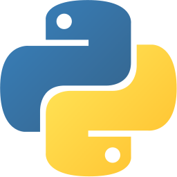
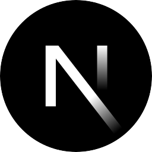
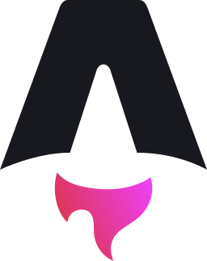
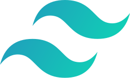
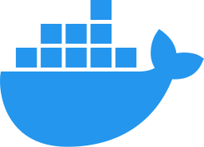
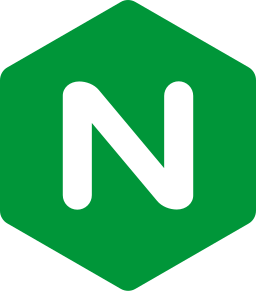
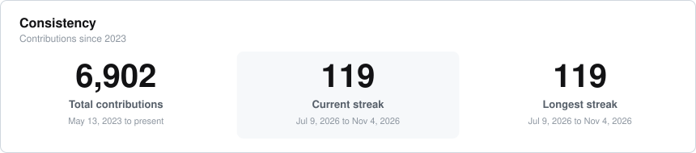
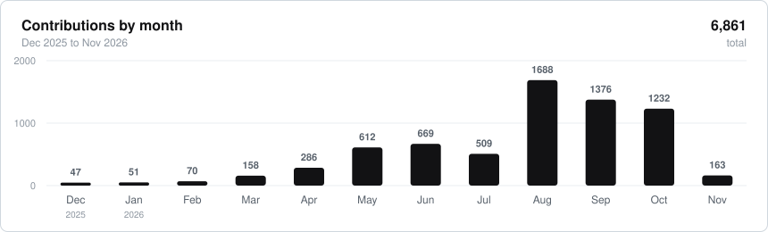

<picture>
  <source media="(prefers-color-scheme: dark)" srcset="https://raw.githubusercontent.com/VanPetegem/VanPetegem/main/assets/avp-mark-dark.svg">
  
</picture>

<h1>Arthur Van Petegem</h1>

<b>Software engineer.</b> I build small, self-owned products end to end.

St. Gallen &nbsp;·&nbsp; Baden, Aargau &nbsp;·&nbsp; Switzerland

  
  
  

<a href="https://gravatar.com/steadyreally1d3bcc5189">gravatar</a>

---

  <a href="https://www.unisg.ch"><picture><source media="(prefers-color-scheme: dark)" srcset="https://raw.githubusercontent.com/VanPetegem/VanPetegem/main/assets/hsg-dark.svg"></picture></a>
  &nbsp;&nbsp;&nbsp;&nbsp;&nbsp;&nbsp;&nbsp;&nbsp;&nbsp;&nbsp;
  <a href="https://www.startglobal.org"><picture><source media="(prefers-color-scheme: dark)" srcset="https://raw.githubusercontent.com/VanPetegem/VanPetegem/main/assets/start-dark.svg"></picture></a>
  &nbsp;&nbsp;&nbsp;&nbsp;&nbsp;&nbsp;&nbsp;&nbsp;&nbsp;&nbsp;
  <a href="https://avp.software"><picture><source media="(prefers-color-scheme: dark)" srcset="https://raw.githubusercontent.com/VanPetegem/VanPetegem/main/assets/avp-mark-dark.svg"></picture></a>

<b>University of St. Gallen</b> · Computer Science &nbsp;&nbsp;&nbsp; <b>START Global</b> · Tech &amp; Innovation &nbsp;&nbsp;&nbsp; <b>AVP Software</b> · Freelance Engineering

---

## What I am building

**[Volunteer Platform](https://volunteer.startglobal.org)** &nbsp;·&nbsp; Coordinates 600+ volunteers for START Summit x Hack. Registration, role and shift assignment, team management, and event-day check-in, built mobile-first for the 95% who are on phones. Next.js, Supabase, Cloudflare Containers.

**[Amber](https://github.com/VanPetegem/Amber)** &nbsp;·&nbsp; Self-hostable personal canvas. Link-in-bio, small site, notebook, blog. Content is markdown on disk, no database lock-in, AGPL-3.0.

**[Hack League](https://hack-league.startglobal.org)** &nbsp;·&nbsp; Hackathon platform for START chapters, with chapter-run events feeding one cross-chapter season leaderboard. SvelteKit, Supabase, Cloudflare Workers.

**[kcal](https://github.com/VanPetegem/calorie-tracker)** &nbsp;·&nbsp; Ad free calorie tracker PWA built for Swiss supermarket products. Barcode scanning, nutrition label photos read by Claude, meal prep batches and adaptive targets. SvelteKit, Cloudflare Workers and D1, MIT.

**[avp.software](https://avp.software)** &nbsp;·&nbsp; My portfolio. Astro with React islands, static output, nginx in a container on a Hetzner box.

---

## Toolkit

&nbsp;&nbsp;&nbsp;

&nbsp;&nbsp;&nbsp;

&nbsp;&nbsp;&nbsp;

&nbsp;&nbsp;&nbsp;

&nbsp;&nbsp;&nbsp;
<picture><source media="(prefers-color-scheme: dark)" srcset="https://raw.githubusercontent.com/VanPetegem/VanPetegem/main/assets/stack/nextjs-dark.svg"></picture>
&nbsp;&nbsp;&nbsp;
<picture><source media="(prefers-color-scheme: dark)" srcset="https://raw.githubusercontent.com/VanPetegem/VanPetegem/main/assets/stack/astro-dark.svg"></picture>
&nbsp;&nbsp;&nbsp;

  
<picture><source media="(prefers-color-scheme: dark)" srcset="https://raw.githubusercontent.com/VanPetegem/VanPetegem/main/assets/stack/threejs-dark.svg"></picture>
&nbsp;&nbsp;&nbsp;

&nbsp;&nbsp;&nbsp;

&nbsp;&nbsp;&nbsp;

&nbsp;&nbsp;&nbsp;

&nbsp;&nbsp;&nbsp;
<picture><source media="(prefers-color-scheme: dark)" srcset="https://raw.githubusercontent.com/VanPetegem/VanPetegem/main/assets/stack/sqlite-dark.svg"></picture>
&nbsp;&nbsp;&nbsp;
<picture><source media="(prefers-color-scheme: dark)" srcset="https://raw.githubusercontent.com/VanPetegem/VanPetegem/main/assets/stack/sentry-dark.svg"></picture>
&nbsp;&nbsp;&nbsp;

---

## Consistency

<picture>
  <source media="(prefers-color-scheme: dark)" srcset="https://raw.githubusercontent.com/VanPetegem/VanPetegem/main/assets/streak-dark.svg">
  
</picture>

  

<picture>
  <source media="(prefers-color-scheme: dark)" srcset="https://raw.githubusercontent.com/VanPetegem/VanPetegem/main/assets/activity-dark.svg">
  
</picture>

